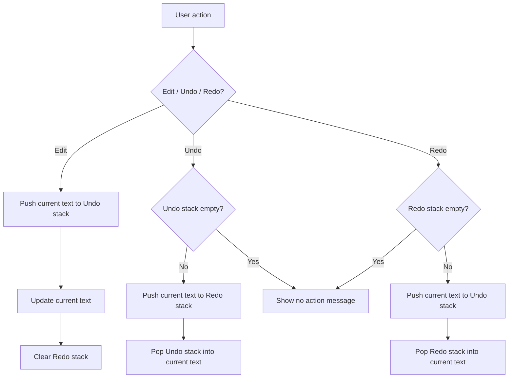

# StackWrite - Undo/Redo Text Editor

A polished Python mini-project for the **DSA Group Activity: Undo/Redo Text Editor using Two Stacks**. It is designed for a clean classroom demonstration and one-click deployment from GitHub with Streamlit Community Cloud.

## What problem does it solve?

Text editors need to let a user reverse a recent action and restore it if the reversal was accidental. StackWrite stores document snapshots so the latest action is always handled first (LIFO).

## Why two stacks?

| Stack | Purpose |
| --- | --- |
| `undo_stack` | Holds document states before each edit. Its top is the next state restored by Undo. |
| `redo_stack` | Holds states removed by Undo. Its top is the next state restored by Redo. |

When a user makes a new edit after Undo, the redo history is cleared because it belongs to an old editing path.

## Algorithm

### Edit(new_text)

1. If `new_text` equals the current document, stop.
2. Push the current document onto `undo_stack`.
3. Make `new_text` the current document.
4. Clear `redo_stack`.

### Undo()

1. If `undo_stack` is empty, show that no action is available.
2. Push the current document onto `redo_stack`.
3. Pop `undo_stack` and make that item the current document.

### Redo()

1. If `redo_stack` is empty, show that no action is available.
2. Push the current document onto `undo_stack`.
3. Pop `redo_stack` and make that item the current document.

## Flowchart



## Complexity analysis

| Operation | Time | Extra space |
| --- | ---: | ---: |
| Edit | O(1)* | O(1)* |
| Undo | O(1)* | O(1)* |
| Redo | O(1)* | O(1)* |

`*` Stack operations themselves are O(1). This snapshot-based demo stores the full document at each history point, so copying a document costs O(n) for `n` characters and total history storage is O(hn) for `h` saved states. Real editors often store small edit commands instead to reduce memory.

## Run it locally

```bash
python -m pip install -r requirements.txt
streamlit run app.py
```

## Test it

```bash
python -m unittest -v
```

## Deploy from GitHub (easy method)

GitHub Pages only hosts static HTML/CSS/JavaScript, so it cannot run this Python app. The simplest free option is Streamlit Community Cloud: it deploys directly from your GitHub repository and redeploys each time you push an update.

1. Create an empty GitHub repository, for example `undo-redo-text-editor`.
2. Upload all files in this folder to the repository root and commit them.
3. Visit [share.streamlit.io](https://share.streamlit.io), sign in with GitHub, and choose **Create app**.
4. Select your repository and branch, then set the main file to `app.py`.
5. Click **Deploy**. Streamlit installs `requirements.txt` automatically and gives you a shareable web link.

## Suggested presentation demo

1. Add a sentence; point out that the prior version appears in the Undo stack.
2. Add another sentence; show the new top of the Undo stack.
3. Press **Undo**; show the current state moving to the Redo stack.
4. Press **Redo**; show it return to the Undo stack.
5. Undo once, type different text, and explain why the Redo stack is cleared.

## Project structure

```text
app.py              # Streamlit user interface
editor_core.py      # Two-stack data-structure logic
test_editor_core.py # Automated behavior tests
requirements.txt    # Deployment dependency
```
